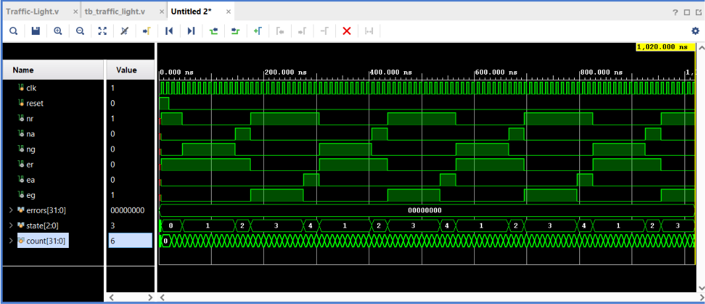

# Traffic Light Controller (Verilog / FPGA)

A traffic light controller for a two-road junction (North and East), designed in
Verilog as a finite state machine (FSM) and verified with a self-checking testbench.

## What it does
- 5 states: ALL_RED (safe reset state), NORTH_GREEN, NORTH_AMBER, EAST_GREEN, EAST_AMBER
- Timing is set with parameters (GREEN_TICKS, AMBER_TICKS), so it can run fast in
  simulation or at real speeds on an FPGA board
- Resets to all-red, and any unexpected state falls back to all-red

## How it's tested
The testbench checks on **every clock tick** that:
1. North and East are **never green at the same time**
2. Each road always shows **exactly one light**

To prove the testbench works, I injected a bug (both directions green during
EAST_GREEN). The testbench caught it: 36 errors, TEST FAILED. The error appears one
clock tick after the bad state starts, because the checker samples on the same clock
edge where the state changes.

**Result:** TEST PASSED, no safety errors.

## Waveform
`state` steps through 0 → 1 → 2 → 3 → 4 → 1… (ALL_RED, then the repeating cycle),
and `errors` stays at 0 for the whole run.

## Bugs I fixed
- **Times printed 1000× too big:** the testbench showed "5000 ns" instead of "5 ns",
  because `%t` prints in picoseconds by default. Fixed with `$timeformat(-9, 0, " ns", 8)`.
- **Test result never printed:** Vivado's default run time (1000 ns) stopped before the
  testbench's final check at 1020 ns. Fixed by using Run All so the test runs to `$finish`.
- **Syntax error from the file name:** Vivado auto-generated `module Traffic-Light`,
  but Verilog names can't contain hyphens (`-` is read as minus). Renamed the module
  to `traffic_light`.

## Project structure
- `rtl/Traffic-Light.v`: the design (FSM)
- `tb/tb_traffic_light.v`: the self-checking testbench

## Tools
Verilog, Vivado 2023.2 (behavioural simulation)

## Next steps (in progress)
- Pedestrian button with a WALK state
- More edge-case tests (reset mid-cycle, button at awkward moments)
- Automated test script + CI with Icarus Verilog

## License
© 2026 Ayub (WaterCompass). All rights reserved.
If you'd like to use any of this code, please contact me first. I'm happy to say yes,
as long as you credit me.